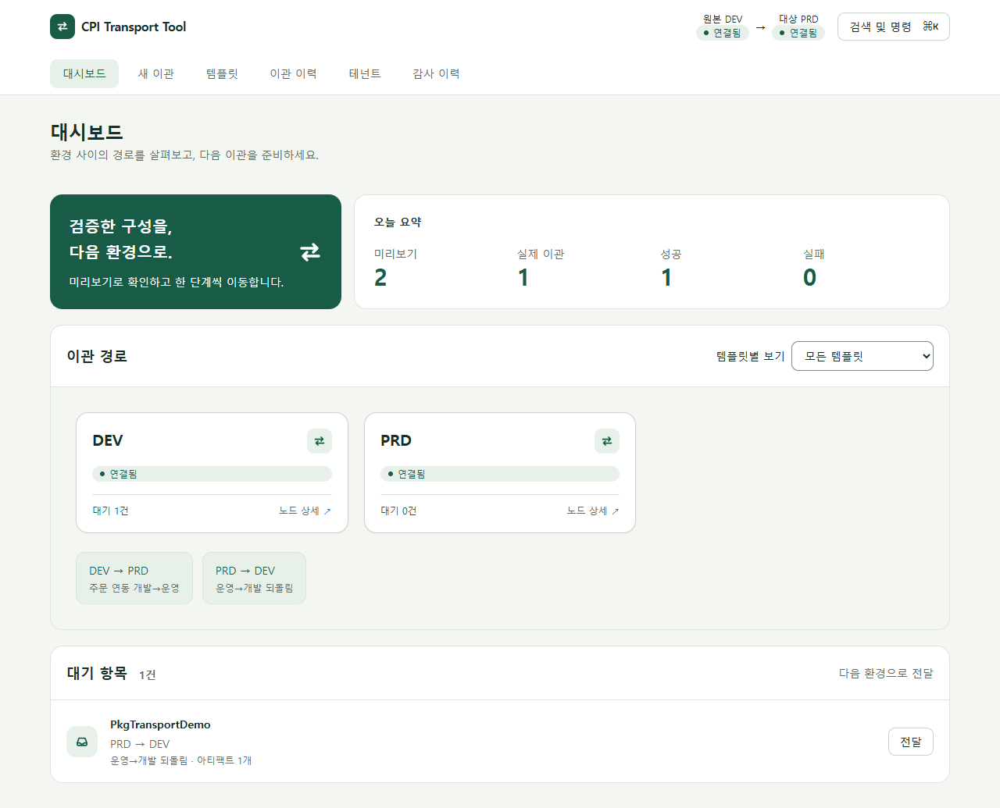
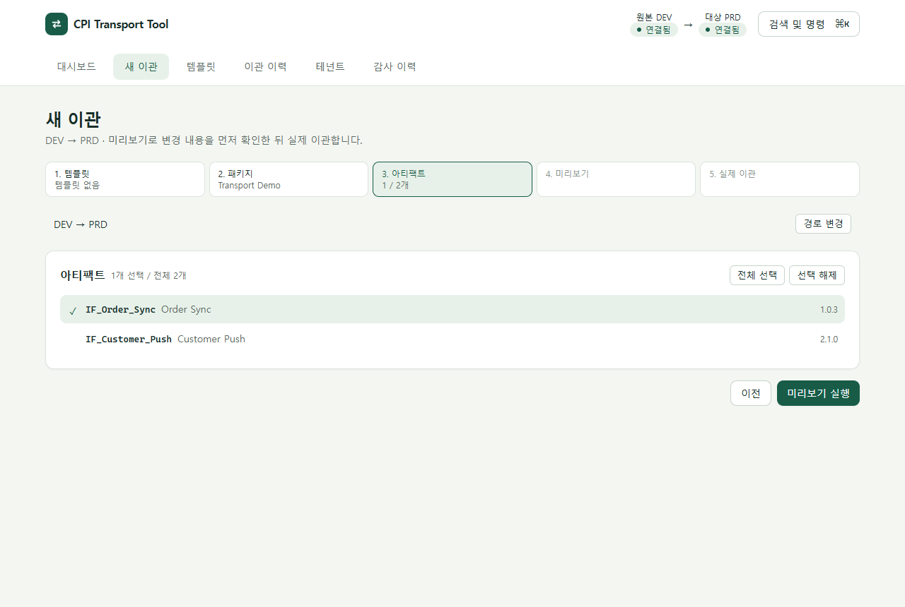
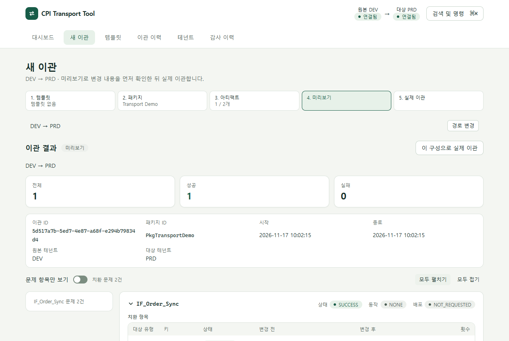
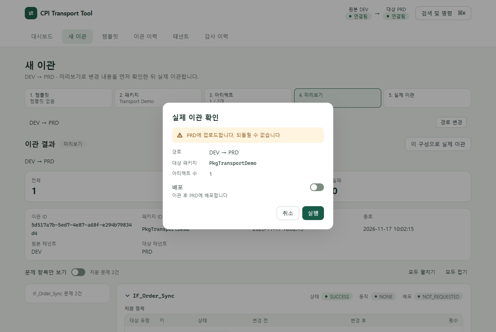
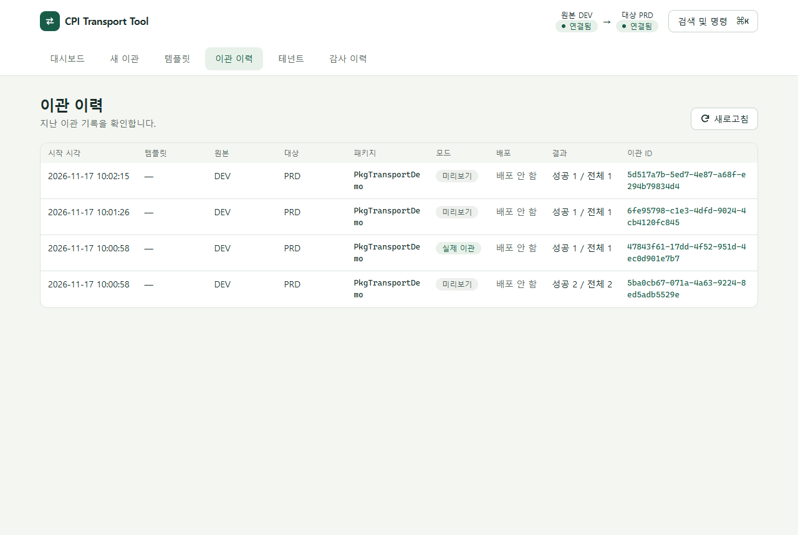

# CPI Transport Tool

SAP Cloud Integration(CPI)의 패키지를 한 테넌트에서 다른 테넌트로 옮기는 사내 도구입니다. 웹 화면에서 원본과 대상 테넌트를 고르고, 옮길 패키지와 아티팩트(iFlow)를 고른 뒤, **미리보기로 결과를 먼저 확인하고** 실제로 옮깁니다.



## 무엇을 할 수 있나요

- **여러 테넌트 사이 이관**: SAP BTP 서비스 키로 테넌트를 등록하고, 등록한 테넌트 중 아무 둘 사이로 패키지를 옮깁니다.
- **미리보기 먼저**: 미리보기는 대상 테넌트에 아무것도 보내지 않고 바뀔 내용만 보여 줍니다. 실제 이관은 미리보기를 한 뒤에만, 확인창을 거쳐서 할 수 있습니다.
- **원본 그대로 이관**: 아티팩트는 원본 그대로 올리고, 구성 값(외부화 파라미터)도 원본 값을 대상에 그대로 복사합니다.
- **템플릿**: 자주 쓰는 경로(원본 → 대상)와 패키지를 이름 붙여 저장해 두고 바로 시작합니다.
- **대시보드**: 테넌트 사이의 경로, 다음 환경으로 넘길 차례인 패키지(대기 항목), 오늘의 이관 수를 한눈에 봅니다.
- **기록**: 모든 이관은 이관 이력에, 테넌트·템플릿 변경은 감사 이력에 남습니다.

## 시작하기 (Docker)

필요한 것은 Docker(Compose 포함)뿐입니다. 앱은 이 PC(`127.0.0.1:8080`)에서만 열립니다.

**1. 설정 파일 만들기**

`docker.env.example`을 `.env`로 복사하고, 테넌트 정보를 암호화할 키(`CPI_TENANT_STORE_KEY`)를 채웁니다. 아래 PowerShell 명령이 키를 만들어 `.env`에 바로 넣습니다. 키는 화면에 나오지 않습니다.

```powershell
Copy-Item docker.env.example .env
$b = New-Object byte[] 32; $r = [System.Security.Cryptography.RandomNumberGenerator]::Create()
try { $r.GetBytes($b) } finally { $r.Dispose() }
(Get-Content .env) -replace '^CPI_TENANT_STORE_KEY=.*', "CPI_TENANT_STORE_KEY=$([Convert]::ToBase64String($b))" | Set-Content -Encoding ascii .env
```

> 이 키는 **처음 한 번만** 만들고 계속 같은 값을 씁니다. 키를 잃거나 바꾸면 등록한 테넌트를 읽을 수 없어 다시 등록해야 합니다. `.env`는 git에 올라가지 않습니다.

**2. 실행**

```powershell
docker compose up -d --build
```

브라우저로 http://localhost:8080/ 을 엽니다. 로그는 `docker compose logs -f app`, 정지는 `docker compose down`입니다.

등록한 테넌트, 템플릿, 이관 이력, 감사 기록은 Docker 볼륨 `cpitt-data`에 남아서 컨테이너를 다시 만들어도 유지됩니다. `docker compose down -v`는 이 볼륨까지 지우니 주의하세요. 코드를 바꾼 뒤에는 `docker compose up -d --build`로 다시 만듭니다.

**3. 읽기 전용 끄기 (실제 이관할 때만)**

처음에는 **읽기 전용**으로 켜져서 미리보기만 됩니다. 미리보기로 결과를 확인한 뒤 실제로 옮길 때만 `.env`의 `CPI_TRANSPORT_READ_ONLY`를 `false`로 바꾸고 `docker compose up -d`로 다시 띄웁니다. 작업이 끝나면 다시 `true`로 돌려 두세요.

## 테넌트 등록

### 서비스 키 준비

1. SAP BTP cockpit의 해당 subaccount/space에서 **Instances and Subscriptions**로 갑니다.
2. **Process Integration Runtime**, plan **api** 서비스 인스턴스를 만듭니다.
3. 그 인스턴스의 **Service Keys**에서 ClientId/Secret 방식의 키를 만듭니다.

필요한 역할은 [SAP Tasks and Permissions](https://help.sap.com/docs/integration-suite/sap-integration-suite/tasks-and-permissions-556d5575d4b0483e85d4f3251f21d0ec)를 확인하세요. 지금까지 쓴 역할의 예는 `WorkspacePackagesRead`, `WorkspacePackagesEdit`, `WorkspaceArtifactsDeploy`, `MonitoringDataRead`입니다. 역할을 추가했다면 키를 다시 발급해야 할 수 있습니다.

> 서비스 키 JSON 파일은 **저장소 밖**에 두세요. 저장소 안으로 복사하지 않습니다.

### 화면에서 등록

**테넌트** 화면에서 **테넌트 등록**을 누르고, 이름을 적은 뒤 서비스 키 JSON 파일을 고르거나 내용을 붙여넣습니다. 등록한 키는 화면에 다시 보이지 않고, 암호화되어 저장됩니다.

- **수정**으로 이름이나 서비스 키를 바꿀 수 있습니다.
- **삭제**는 이 도구에 등록한 정보만 지웁니다. SAP 테넌트의 패키지는 그대로입니다. 그 테넌트를 쓰는 템플릿이 있으면 확인창에서 템플릿까지 함께 지울지 고를 수 있습니다.
- 화면 오른쪽 위의 연결 상태(예: `원본 DEV 연결됨`)를 누르면 연결을 다시 확인합니다.

## 사용 방법

### 1. 새 이관

**새 이관** 메뉴는 다섯 단계로 진행합니다. 위쪽 단계 줄을 눌러 지난 단계로 돌아갈 수 있습니다.

1. **템플릿**: 저장한 템플릿으로 시작하거나 **템플릿 없이 진행**을 고릅니다.
2. **패키지**: 원본 테넌트의 패키지 목록에서 하나를 고릅니다. 원본·대상을 바꾸려면 **경로 변경**을 누릅니다.
3. **아티팩트**: 옮길 아티팩트를 고릅니다. 하나도 고르지 않으면 패키지의 모든 아티팩트가 대상입니다. 키보드로도 고를 수 있습니다(↑↓ 이동, Space 선택, Shift+↑↓ 범위 선택, Ctrl+A 전체 선택).
4. **미리보기**: **미리보기 실행**을 누르면 아티팩트마다 어떤 값이 어떻게 바뀌는지 보여 줍니다. 대상에는 아무것도 보내지 않습니다. **문제 항목만 보기**를 켜면 확인이 필요한 항목만 남습니다.
5. **실제 이관**: 결과의 **이 구성으로 실제 이관**을 누르면 확인창이 뜹니다. 경로, 패키지, 아티팩트 수를 확인하고 **실행**을 눌러야 옮겨집니다. 배포까지 하려면 확인창의 **배포** 스위치를 켭니다(항상 꺼진 채로 시작합니다).







실제 이관이 막혀 있다면 버튼 아래에 이유가 보입니다. 다음 경우에는 실제 이관을 할 수 없습니다(미리보기는 됩니다).

- 읽기 전용이 켜져 있을 때
- 연결 상태를 확인하지 못했을 때
- 대상 테넌트의 연결 확인이 실패했을 때

### 2. 템플릿

**템플릿** 화면에서 **템플릿 만들기**로 이름, 원본, 대상, (선택) 패키지를 저장합니다. 목록의 **이 템플릿으로 이관**을 누르면 그 경로와 패키지가 채워진 새 이관이 열립니다. 템플릿으로 시작한 이관은 이력에 템플릿 이름이 함께 남습니다.

### 3. 대시보드

- **이관 경로**: 테넌트를 템플릿 흐름 순서로 보여 줍니다. 테넌트를 누르면 연결 정보, 그 테넌트를 쓰는 템플릿, 최근 이관 5건이 나옵니다. **템플릿별 보기**로 한 템플릿의 경로만 볼 수 있습니다.
- **대기 항목**: 한 테넌트로 이관에 성공했고, 그 테넌트에서 다음 환경으로 가는 템플릿이 있는데 아직 넘기지 않은 패키지입니다. **전달**을 누르면 그 템플릿과 패키지로 채워진 새 이관(아티팩트 단계)이 열립니다. 자동으로 실행되지는 않습니다.
- **오늘 요약**: 오늘의 미리보기·실제 이관 수와 성공·실패 수입니다.

### 4. 이력

- **이관 이력**: 지난 이관 목록(모드, 배포 결과, 성공 수)입니다. 행을 누르면 그때의 결과를 다시 봅니다.
- **감사 이력**: 테넌트·템플릿의 등록·수정·삭제와 이관 기록을 시간순으로 모아 봅니다. 서비스 키 내용은 남지 않습니다.



어느 화면에서든 **Ctrl+K**(Mac은 ⌘K)를 누르면 검색 및 명령 창이 열립니다. 화면 이동, 템플릿·패키지 찾기, 미리보기 실행 등을 키보드로 할 수 있습니다.

## 구성 값 (외부화 파라미터)

아티팩트는 원본에서 내려받은 그대로 대상에 올립니다(iFlow 내용을 바꾸지 않습니다). 구성 값(외부화 파라미터)은 원본에서 대상으로 그대로 복사됩니다(민감 키 포함, 값은 결과 화면과 이관 이력 파일에 평문으로 남는다). 대상 값은 읽어 비교하지 않고 모두 씁니다.

- 결과 카드의 **구성 값** 표에서 키마다 값과 상태(복사 예정·복사됨·빈 값이라 건너뜀·실패)를 봅니다.
- 이름에 `password`, `secret`, `token` 등이 들어간 민감 키는 원본 값이 비어 있으면(SAP가 보안 값을 돌려주지 않는 경우) 대상 값을 덮어쓰지 않고 건너뜁니다.
- 결과 화면과 이관 이력 파일에는 민감 키 값도 평문으로 남으니, 공유하기 전에 확인하세요. 애플리케이션 로그에는 구성 값의 값을 남기지 않습니다.
- 값을 대상 환경에 맞게 바꾸는 기능(매핑)은 없앴습니다. 예전 `CPI_TRANSPORT_MAPPINGFILE` 설정이 남아 있어도 무시됩니다.

## 알아 두면 좋은 점

- **대상에 같은 패키지가 미리 있어야 합니다.** 이 도구는 패키지를 새로 만들지 않습니다.
- **대상 아티팩트가 SAP 화면에서 편집 중이면**(잠김, Draft) 업로드가 실패(UPLOAD_FAILED)합니다. SAP 화면에서 편집을 저장(Save as version)하거나 취소한 뒤 다시 이관하세요. 도구가 잠금을 풀지는 않습니다.
- **배포에 실패하면** 결과와 이력 상세에 SAP가 알려 준 오류 내용이 보입니다. 비밀값·토큰·호스트처럼 보이는 글자는 가려서 보이지만, 모든 민감값이 가려진다는 보장은 없으니 공유하기 전에 직접 확인하세요. 배포에 실패한 아티팩트는 대상에 그대로 남습니다(도구가 지우거나 배포를 해제하지 않음).

## 버전

- 버전은 `build.gradle`의 `version` 하나에서 정합니다(0.x 유의적 버전). 실행 중인 앱의 버전과 커밋은 세 곳에서 봅니다.
  - 화면 맨 아래: `v0.1.0 · abc1234`
  - API: `GET /version` → `{"version":"0.1.0","commit":"abc1234","buildTime":"2026-11-20T10:00:00Z"}`
  - 기동 로그 한 줄: `CPI Transport Tool 0.1.0 (커밋 abc1234, 빌드 2026-11-20T10:00:00Z)` (Docker는 `docker compose logs app`)
- 커밋을 알 수 없으면 `unknown`(예: 저장소 밖이나 git worktree에서 Docker 빌드), 빌드 정보 없이 실행하면 버전이 `dev`입니다.
- 번호 규칙: main 병합 하나가 버전 하나입니다. `feat/` 병합은 minor(0.1.0 → 0.2.0), `fix/` 병합은 patch(0.2.0 → 0.2.1)를 올립니다. `docs/`·`chore/`·`spike/` 병합은 버전을 올리지 않고 태그도 붙이지 않습니다. 접두사가 이 규칙에 맞지 않으면 병합하는 사람이 기능인지 수정인지 정합니다.
- 병합 절차(브랜치는 `version`을 바꾸지 않습니다):
  1. `git merge --no-ff --no-commit <브랜치>`
  2. `build.gradle`의 `version`을 올리고, [CHANGELOG.md](CHANGELOG.md)의 `## 미출시` 항목을 `## X.Y.Z — YYYY-MM-DD`로 옮깁니다(버전을 올리지 않는 병합이면 `## 미출시`에 한 줄 더함)
  3. 두 파일을 `git add` 하고 병합 커밋을 만듭니다
  4. 버전을 올렸으면 `git tag -a vX.Y.Z -m "X.Y.Z"` (병합 커밋에)

## 개발자용

- 구조: 백엔드는 Spring Boot(`src/`), 화면은 React + TypeScript + Vite(`frontend/`)이고, 화면 빌드 결과가 실행형 JAR 안에 함께 들어갑니다.
- 필요한 것: JDK 25(Gradle toolchain), Node.js 24 이상과 npm
- 테스트:
  - 백엔드 테스트: `./gradlew test` (PowerShell은 `.\gradlew.bat test`)
  - 화면 단위 테스트와 빌드: `frontend/`에서 `npm test`, `npm run build`
  - 전체 검사(위 두 가지와 실행형 JAR, 브라우저 E2E): `python .claude/wf3/check.py`. 브라우저 E2E는 실제 테넌트에 접속하지 않습니다. 자세한 내용은 [e2e/README.md](e2e/README.md)에 있습니다.
- 실행형 JAR 만들기: `./gradlew bootJar` → `build/libs/cpi-transport-tool-<버전>.jar`
