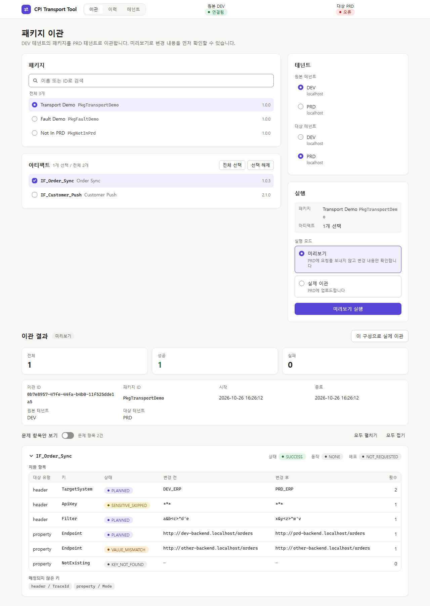
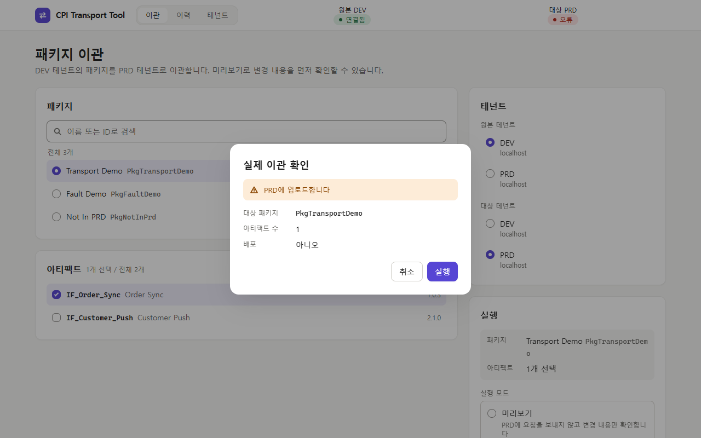
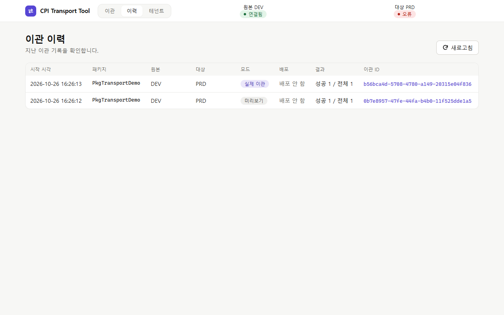
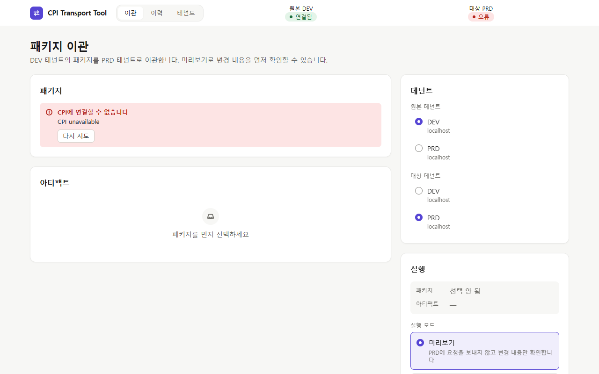

# CPI Transport Tool

## 실행 방법

필요한 것: JDK 25(Gradle toolchain이 사용), Node.js 24 이상과 npm, 비어 있는 포트 8080·18081·18082. 저장소 루트에서 실행하며, 실제 SAP CPI 없이 로컬 스텁과 더미 자격증명으로 실행됩니다.

**터미널 1: 스텁 기동**

PowerShell 5.1:

```powershell
.\gradlew.bat runLocalStubs
```

Git Bash:

```bash
./gradlew runLocalStubs
```

**터미널 2: 더미 환경 변수 설정, 프론트 빌드, 앱 기동**

스텁으로 실제 이관까지 해 보려면 `CPI_TRANSPORT_READ_ONLY=false`를 함께 줍니다(PowerShell: `$env:CPI_TRANSPORT_READ_ONLY = 'false'`).

PowerShell 5.1:

```powershell
$env:CPI_DEV_API_URL = 'http://localhost:18081'
$env:CPI_DEV_TOKEN_URL = 'http://localhost:18081/oauth/token'
$env:CPI_DEV_CLIENT_ID = 'dummy-dev-client'
$env:CPI_DEV_CLIENT_SECRET = 'dummy-dev-secret'
$env:CPI_PRD_API_URL = 'http://localhost:18082'
$env:CPI_PRD_TOKEN_URL = 'http://localhost:18082/oauth/token'
$env:CPI_PRD_CLIENT_ID = 'dummy-prd-client'
$env:CPI_PRD_CLIENT_SECRET = 'dummy-prd-secret'
New-Item -ItemType Directory -Force build/local-stubs | Out-Null
$env:CPI_TRANSPORT_MAPPINGFILE = 'examples/mapping-example.yml'
$env:CPI_TRANSPORT_HISTORY_FILE = 'build/local-stubs/history.jsonl'
$env:LOGGING_FILE_NAME = 'build/local-stubs/app.log'
.\gradlew.bat frontendBuild
.\gradlew.bat bootRun
```

Git Bash:

```bash
export CPI_DEV_API_URL=http://localhost:18081
export CPI_DEV_TOKEN_URL=http://localhost:18081/oauth/token
export CPI_DEV_CLIENT_ID=dummy-dev-client
export CPI_DEV_CLIENT_SECRET=dummy-dev-secret
export CPI_PRD_API_URL=http://localhost:18082
export CPI_PRD_TOKEN_URL=http://localhost:18082/oauth/token
export CPI_PRD_CLIENT_ID=dummy-prd-client
export CPI_PRD_CLIENT_SECRET=dummy-prd-secret
mkdir -p build/local-stubs
export CPI_TRANSPORT_MAPPINGFILE=examples/mapping-example.yml
export CPI_TRANSPORT_HISTORY_FILE=build/local-stubs/history.jsonl
export LOGGING_FILE_NAME=build/local-stubs/app.log
./gradlew frontendBuild
./gradlew bootRun
```

**브라우저**로 http://localhost:8080/ 을 엽니다. 정지는 두 터미널에서 Ctrl+C입니다. 자세한 절차는 아래 [1절](#1-스텁-기동-터미널-1), [2절](#2-앱-기동-터미널-2), [5절](#5-요청-저널시나리오-초기화와-정지), [6절](#6-화면프론트엔드)을 봅니다.

SAP Cloud Integration(CPI)의 DEV 패키지를 PRD로 이관하는 도구입니다. 웹 화면과 REST API를 제공합니다.

- 패키지와 아티팩트(iFlow)를 골라 DEV에서 PRD로 이관합니다.
- 매핑 파일(YAML 또는 JSON)로 Content Modifier와 Externalized Parameter 값을 PRD 값으로 치환합니다.
- 미리보기(dry run, 기본값)로 PRD를 건드리지 않고 결과를 먼저 확인한 뒤, 확인 대화상자를 거쳐 실제 이관을 실행합니다.
- 이관 결과를 이력으로 남기고 화면에서 다시 볼 수 있습니다.

실행 방법 절과 아래 번호 절의 로컬 데모는 실제 테넌트 없이 localhost WireMock 스텁과 더미 자격증명만 사용합니다.

실제 테넌트를 연결하는 절차와 검증 시 주의점은 다음 절을 따릅니다.

## 테넌트 등록과 실제 테넌트로 이관하기

### 서비스 키와 저장소 준비

SAP BTP cockpit의 해당 subaccount/space에서 **Instances and Subscriptions**로 이동해 **Process Integration Runtime**, plan **api** 서비스 인스턴스를 만들고, 그 인스턴스의 **Service Keys**에서 ClientId/Secret 방식의 서비스 키를 만듭니다. 이관·배포에 필요한 역할 이름과 권한은 [SAP Tasks and Permissions](https://help.sap.com/docs/integration-suite/sap-integration-suite/tasks-and-permissions-556d5575d4b0483e85d4f3251f21d0ec)와 [서비스 인스턴스·키 준비 안내](https://developers.sap.com/tutorials/btp-transport-management-cpi-03-set-up-target-account)를 확인하세요. 이 run에서 필요했던 역할 계열의 예시는 `WorkspacePackagesRead`·`WorkspacePackagesEdit`·`WorkspaceArtifactsDeploy`·`MonitoringDataRead`이며, 모든 환경에 대한 완전한 권한 목록은 아닙니다. 역할을 추가한 뒤에는 키를 다시 발급해야 할 수 있습니다.

서비스 키 JSON 파일은 **저장소 밖**에 보관하세요. `.gitignore`는 `*service-key*.json`, `*api-key*.json`, `*.servicekey.json`, `*.enc`, `.env`, `.env.*`를 무시합니다. 파일 이름이 이 패턴에 맞더라도 저장소 안에 키를 복사하지 마세요.

등록 테넌트의 연결 정보는 AES-GCM으로 암호화해 기본 `~/.cpi-transport-tool/tenants.enc`에 보관합니다. 위치는 `cpi.tenants.store-file`로 지정할 수 있습니다. 암호화 키는 **환경 변수 `CPI_TENANT_STORE_KEY`로만** 받으며, 32바이트 임의 값의 base64 문자열이어야 합니다. 최초 한 번 다음 중 하나로 만들고, 이후 재기동 때는 안전하게 보관한 **같은 키**를 사용하세요. 명령은 키를 화면에 출력하지 않습니다.

PowerShell 5.1:

```powershell
$storeKeyBytes = New-Object byte[] 32
$storeKeyRng = [System.Security.Cryptography.RandomNumberGenerator]::Create()
try { $storeKeyRng.GetBytes($storeKeyBytes) } finally { $storeKeyRng.Dispose() }
$env:CPI_TENANT_STORE_KEY = [Convert]::ToBase64String($storeKeyBytes)
```

Git Bash:

```bash
export CPI_TENANT_STORE_KEY="$(openssl rand -base64 32)"
```

키를 잃으면 기존 저장 파일을 복호화할 수 없습니다. 새 저장 파일 위치를 지정하고 새 키로 테넌트를 다시 등록해야 합니다. 키가 없거나 저장 파일을 읽지 못하면 등록 테넌트의 쓰기 작업은 막힙니다. 재기동할 때 위 생성 명령을 반복해 기존 키를 바꾸지 마세요.

### 화면 등록과 이관 준비

1. 앱을 실행하고 **테넌트** 탭에서 이름을 입력한 뒤 서비스 키 JSON 파일을 선택하거나 내용을 붙여넣어 등록합니다. 파일을 선택하면 파일 내용을 우선 사용합니다. 등록된 키는 다시 보이지 않습니다.
2. 목록의 **수정**에서 이름 또는 서비스 키를 바꾸고, **삭제**에서 로컬 등록을 지울 수 있습니다. 수정 폼은 현재 이름과 빈 서비스 키 입력으로 열립니다. 로컬 등록 삭제는 SAP 테넌트의 패키지·아티팩트를 삭제하지 않습니다.
3. 기존 연결 환경 변수 4개(`CPI_DEV_API_URL`, `CPI_DEV_TOKEN_URL`, `CPI_DEV_CLIENT_ID`, `CPI_DEV_CLIENT_SECRET`; PRD는 `CPI_PRD_*`)를 모두 주면 초기 등록 **DEV·PRD**로 계속 사용할 수 있습니다. 환경 변수로 등록한 항목은 화면에서 수정·삭제할 수 없습니다.
4. 이관 탭의 **원본 테넌트**·**대상 테넌트** 라디오에서 서로 다른 테넌트를 선택합니다. 상단 연결 상태 칩을 눌러 다시 확인할 수 있습니다. 대상 미선택은 **대상 선택 안 됨**, 상태 요청 자체 실패는 **확인 실패**로 보입니다.
5. 읽기 전용은 **기본 켜짐**입니다. 미리보기를 확인한 뒤에만 `CPI_TRANSPORT_READ_ONLY=false`를 주고 앱을 재기동하세요. 이 설정을 끄면 실제 대상에 업로드·파라미터 변경·배포를 수행할 수 있으므로 대상 이름과 확인 대화상자를 확인하세요.
6. **대상 패키지가 미리 있어야 합니다.** 도구는 패키지를 자동 생성하지 않습니다. 매핑의 `devValue`는 원본 테넌트 값, `prdValue`는 대상 테넌트 값입니다. 원본·대상을 바꿀 때 매핑도 확인하세요.

### 실제 검증 절차

실제 검증은 기본 `gradle test`(`./gradlew test`)에 들어 있지 않습니다. 아래 절차는 서비스 키를 직접 등록하고 대상을 선택하는 별도 수동 절차입니다. 실제 서비스 키를 등록하거나 초기 연결 환경 변수로 제공하지 않으면 실제 테넌트에 요청하지 않습니다. 앞 절의 로컬 PRD 더미 환경 변수가 남지 않은 새 터미널에서 시작하세요.

1. 대상에 패키지 `CPITransportRealTest`를 준비합니다. 터미널 1에서 샘플 원본 스텁을 띄웁니다(PowerShell은 `.\gradlew.bat runRealSampleStub`, Git Bash는 `./gradlew runRealSampleStub`). 기본 샘플 아티팩트는 `CPITT_Sample_Push` 하나입니다.
2. 터미널 2에서 위에서 준비한 저장소 키와 다음 DEV 더미 환경 변수, 매핑을 설정하고 앱을 실행합니다. 저장소 키를 같은 터미널에 먼저 설정하거나 안전한 보관소에서 복원하세요. 처음에는 읽기 전용을 켭니다.

```powershell
$env:CPI_DEV_API_URL = 'http://localhost:18081'
$env:CPI_DEV_TOKEN_URL = 'http://localhost:18081/oauth/token'
$env:CPI_DEV_CLIENT_ID = 'dummy-dev-client'
$env:CPI_DEV_CLIENT_SECRET = 'dummy-dev-secret'
$env:CPI_TRANSPORT_MAPPINGFILE = 'examples/real-transport-mapping.yml'
$env:CPI_TRANSPORT_READ_ONLY = 'true'
.\gradlew.bat frontendBuild
.\gradlew.bat bootRun
```

```bash
export CPI_DEV_API_URL=http://localhost:18081
export CPI_DEV_TOKEN_URL=http://localhost:18081/oauth/token
export CPI_DEV_CLIENT_ID=dummy-dev-client
export CPI_DEV_CLIENT_SECRET=dummy-dev-secret
export CPI_TRANSPORT_MAPPINGFILE=examples/real-transport-mapping.yml
export CPI_TRANSPORT_READ_ONLY=true
./gradlew frontendBuild
./gradlew bootRun
```

3. 브라우저로 http://localhost:8080/ 을 열고 테넌트 탭에서 대상 서비스 키를 등록합니다. 원본 DEV와 등록한 대상을 선택하고 칩으로 연결 상태를 확인합니다. 패키지 `CPITransportRealTest`와 `CPITT_Sample_Push`를 선택해 미리보기를 실행합니다. `examples/real-transport-mapping.yml`의 header·property·외부화 파라미터가 PLANNED인지 확인합니다. 미리보기는 대상에 요청하지 않습니다.
4. 앱을 Ctrl+C로 정지하고 같은 저장소 키·저장 파일을 유지한 채 PowerShell `$env:CPI_TRANSPORT_READ_ONLY = 'false'` 또는 Git Bash `export CPI_TRANSPORT_READ_ONLY=false`를 설정한 뒤 `bootRun`으로 재기동합니다. 등록 대상이 유지되는지 확인하고 원본·대상을 다시 선택합니다. 먼저 배포를 끈 실제 이관을 실행해 대상 SAP 화면에서 아티팩트와 치환값을 확인합니다.
5. 이어서 배포 포함 실제 이관을 실행합니다. 대상 SAP 화면에서 배포·기동 상태를 확인하고, 도구의 이관 결과·이력 상세에서 **배포 성공 1개**, 이력 목록의 **배포** 열에서 **성공**을 확인합니다. 검증 후 읽기 전용을 다시 켜고 재기동하면 실제 이관은 막히고 미리보기는 계속 사용할 수 있습니다.

대상 아티팩트가 SAP 화면에서 편집 중(잠금, 버전 상태 Draft)이면 업로드가 HTTP 400(UPLOAD_FAILED)으로 거절된다. 화면에서 편집을 끝낸 뒤(Save as version 또는 Cancel) 다시 이관한다. 이 run의 실제 확인에 따른 안내이며, 도구는 잠금을 자동으로 풀지 않습니다.

### 배포 실패 재현과 상세 확인

기본 샘플 스텁을 Ctrl+C로 정지하고 `./gradlew runRealSampleStub -PsampleVariant=deployFail`(PowerShell: `.\gradlew.bat runRealSampleStub -PsampleVariant=deployFail`)로 변형 스텁을 띄웁니다. 이 변형은 `CPITransportRealTest`에 `CPITT_Sample_DeployFail` 하나만 제공합니다. 이관 탭에서 패키지를 다시 조회하고 이 아티팩트를 선택한 뒤, 읽기 전용을 끈 앱에서 **배포 포함**(`deploy: true`)으로 실제 이관하세요. 이 변형에는 예제 매핑 항목이 없어 치환 결과는 비어 있습니다.

이관 결과와 이력 상세에서 **배포 실패** 요약과 **배포 오류 상세**를 확인합니다. 이력 목록의 **배포** 열에는 배포 결과 **실패 1**이 표시됩니다. 이 아티팩트는 대상에 ERROR 배포 상태로 남으며 도구는 삭제·배포 해제를 하지 않습니다. STARTED·TIMEOUT 또는 통신 실패로 끝나면 의도한 런타임 배포 오류를 재현한 것으로 보지 않습니다. 런타임 ERROR여도 상세 API가 200과 본문을 주지 않으면 상세를 확인하지 못한 것입니다.

일반 이관에서도 배포를 요청하면 이관 결과·이력 상세에 배포 성공·실패·시간 초과 요약이 표시되고, 이력 목록의 배포 열에서 결과를 볼 수 있습니다. 상세를 가져오지 못하면 HTTP 상태 또는 응답 없음 안내가 나옵니다. 상세는 CPI가 알려 준 원문에서 비밀값·인증 헤더·토큰/JWT·대상 호스트의 서브도메인·민감 매핑값 패턴을 가린 뒤 4000자(코드 포인트)까지 표시하며, 넘으면 `…(잘림)`을 붙입니다. 마스킹된 상세는 응답과 이력에 저장되고 앱 로그에는 원문과 마스킹한 상세 모두 남기지 않습니다. **텍스트 패턴 마스킹이므로 알 수 없는 민감값은 가려지지 않을 수 있습니다.** 공유 전에 상세 내용을 직접 확인하세요.

## 화면



이관 탭: 패키지·아티팩트를 선택하고 실행 모드를 "미리보기"로 실행한 결과입니다. 결과에서는 아티팩트 카드를 접고 펼 수 있고 "문제 항목만 보기"로 확인이 필요한 항목만 모아 볼 수 있으며, 미리보기 결과에서 "이 구성으로 실제 이관"으로 이어 갈 수 있습니다.



실행 모드를 "실제 이관"으로 바꿔 "PRD로 이관"을 누르면 뜨는 확인 대화상자입니다. 대상 패키지, 아티팩트 수, 배포 여부를 확인하고 "실행"을 눌러야 이관됩니다.



이력 탭: 지난 이관 목록(모드, 배포, 결과)이며 이관 ID를 누르거나 행을 누르면 상세 결과를 봅니다.



오류가 나면 원인을 안내하고 다시 시도 버튼을 보여 줍니다.

## 사전 조건

- 저장소 루트에서 실행합니다. Gradle Wrapper와 JDK 25 toolchain이 필요합니다. PATH의 Java 21로 앱을 직접 실행하지 않습니다.
- DEV 18081, PRD 18082, 앱 8080 포트가 비어 있어야 합니다.
- 터미널 3개를 사용합니다: 스텁, 앱, API 호출. 각 서버는 포그라운드로 실행하고 해당 터미널에서 Ctrl+C로 정지합니다.
- 테스트: PowerShell ` .\gradlew.bat test`, Git Bash `./gradlew test`.

## 1. 스텁 기동 (터미널 1)

PowerShell 5.1:

```powershell
.\gradlew.bat runLocalStubs
```

Git Bash:

```bash
./gradlew runLocalStubs
```

`Local CPI stubs: DEV=http://localhost:18081 PRD=http://localhost:18082` 출력으로 확인합니다. DEV 원본 ZIP은 `build/local-stubs/dev-zips/<ArtifactId>.zip`에 생성됩니다.

## 2. 앱 기동 (터미널 2)

DEV+PRD 설정, 예제 YAML 매핑, 로컬 이력·로그 경로를 지정합니다. JSON 매핑을 쓰려면 `examples/mapping-example.json`으로 바꿉니다. 두 파일의 매핑 내용은 같습니다.

PowerShell 5.1:

```powershell
$env:CPI_DEV_API_URL = 'http://localhost:18081'
$env:CPI_DEV_TOKEN_URL = 'http://localhost:18081/oauth/token'
$env:CPI_DEV_CLIENT_ID = 'dummy-dev-client'
$env:CPI_DEV_CLIENT_SECRET = 'dummy-dev-secret'
$env:CPI_PRD_API_URL = 'http://localhost:18082'
$env:CPI_PRD_TOKEN_URL = 'http://localhost:18082/oauth/token'
$env:CPI_PRD_CLIENT_ID = 'dummy-prd-client'
$env:CPI_PRD_CLIENT_SECRET = 'dummy-prd-secret'
New-Item -ItemType Directory -Force build/local-stubs | Out-Null
$env:CPI_TRANSPORT_MAPPINGFILE = 'examples/mapping-example.yml'
$env:CPI_TRANSPORT_HISTORY_FILE = 'build/local-stubs/history.jsonl'
$env:LOGGING_FILE_NAME = 'build/local-stubs/app.log'
.\gradlew.bat bootRun
```

Git Bash:

```bash
export CPI_DEV_API_URL=http://localhost:18081
export CPI_DEV_TOKEN_URL=http://localhost:18081/oauth/token
export CPI_DEV_CLIENT_ID=dummy-dev-client
export CPI_DEV_CLIENT_SECRET=dummy-dev-secret
export CPI_PRD_API_URL=http://localhost:18082
export CPI_PRD_TOKEN_URL=http://localhost:18082/oauth/token
export CPI_PRD_CLIENT_ID=dummy-prd-client
export CPI_PRD_CLIENT_SECRET=dummy-prd-secret
mkdir -p build/local-stubs
export CPI_TRANSPORT_MAPPINGFILE=examples/mapping-example.yml
export CPI_TRANSPORT_HISTORY_FILE=build/local-stubs/history.jsonl
export LOGGING_FILE_NAME=build/local-stubs/app.log
./gradlew bootRun
```

DEV만 설정하려면 앱을 정지하고 위 DEV·매핑·이력 설정을 유지한 채 다음 명령으로 PRD 환경 변수를 해제하고 다시 실행합니다. DEV 조회는 가능하며 PRD가 필요한 이관은 환경 미설정 오류가 됩니다.

```powershell
$env:CPI_PRD_API_URL = $null
$env:CPI_PRD_TOKEN_URL = $null
$env:CPI_PRD_CLIENT_ID = $null
$env:CPI_PRD_CLIENT_SECRET = $null
.\gradlew.bat bootRun
```

```bash
unset CPI_PRD_API_URL CPI_PRD_TOKEN_URL CPI_PRD_CLIENT_ID CPI_PRD_CLIENT_SECRET
./gradlew bootRun
```

## 3. 준비 확인과 이관 (터미널 3)

DEV+PRD 앱의 `Started CpiTransportToolApplication` 로그를 확인한 뒤 실행합니다. 준비 확인은 HTTP 200이어야 합니다. PowerShell의 `curl` 별칭 대신 `curl.exe`를 사용하며 JSON은 파일로 전달합니다.

PowerShell 5.1:

```powershell
curl.exe -s -o NUL -w "%{http_code}" http://localhost:18082/__admin/mappings
curl.exe -s -o NUL -w "%{http_code}" http://localhost:8080/transport/history
Set-Content -Path build/local-stubs/body-transport.json -Value '{"packageId":"PkgTransportDemo"}' -Encoding Ascii -NoNewline
curl.exe -s -o build/local-stubs/transport-response.json -w "%{http_code}" -X POST http://localhost:8080/transport -H "Content-Type: application/json" --data-binary "@build/local-stubs/body-transport.json"
Get-Content build/local-stubs/transport-response.json
```

Git Bash:

```bash
curl -s -o /dev/null -w '%{http_code}\n' http://localhost:18082/__admin/mappings
curl -s -o /dev/null -w '%{http_code}\n' http://localhost:8080/transport/history
printf '%s' '{"packageId":"PkgTransportDemo"}' > build/local-stubs/body-transport.json
curl -s -o build/local-stubs/transport-response.json -w '%{http_code}\n' -X POST http://localhost:8080/transport -H 'Content-Type: application/json' --data-binary @build/local-stubs/body-transport.json
cat build/local-stubs/transport-response.json
```

초기 상태에서 예제 이관은 HTTP 200, 응답의 `APPLIED` 1건 이상, 업로드 요청 2건을 기대합니다. 미리보기(`"dryRun":true`)는 본문에 이 필드를 추가해 요청합니다(업로드 없음).

## 4. 업로드 ZIP 확인

PowerShell 5.1:

```powershell
.\gradlew.bat extractUploadedArtifacts
# 포트를 변경해서 스텁을 실행한 경우:
.\gradlew.bat extractUploadedArtifacts --args="18082"
curl.exe -s http://localhost:18082/__admin/requests -o build/local-stubs/prd-requests.json
```

Git Bash:

```bash
./gradlew extractUploadedArtifacts
./gradlew extractUploadedArtifacts --args='18082'
curl -s http://localhost:18082/__admin/requests -o build/local-stubs/prd-requests.json
```

PRD 포트 인자의 기본값은 18082이며 호스트는 localhost로 고정됩니다. 관리 API는 `GET http://localhost:18082/__admin/requests`입니다. 도구는 생성 POST와 아티팩트 업데이트 PUT의 `ArtifactContent`를 Base64 디코드합니다. 파라미터 PUT 등은 제외합니다.

- ZIP: `build/local-stubs/uploads/<순번>-<ArtifactId>.zip`
- 추출한 `.iflw`: `build/local-stubs/uploads/<순번>-<ArtifactId>/<엔트리 경로>`
- 표: `SOURCE / ARTIFACT / ENTRY / BYTES / SHA-256 / FILE`. `[ZIP]` 행은 ZIP 전체, 나머지는 압축 해제한 각 엔트리의 실제 크기와 SHA-256입니다. `UPLOAD`와 `DEV` 행에서 동일한 엔트리를 비교합니다.
- `IF_Order_Sync`의 `.iflw` 이외 엔트리 SHA-256은 DEV 원본과 같아야 합니다. ZIP 전체 해시는 재압축 때문에 다를 수 있습니다.
- 원본이 없으면 `DEV MISSING`을 표시합니다. 업로드가 없으면 `Upload requests: 0`입니다. 실패한 업로드 시도와 재시도도 각각 기록하므로 요청 건수는 성공 건수와 다를 수 있습니다.
- 실행마다 현재 저널을 시간순으로 읽습니다. 같은 출력 이름은 덮어쓰며 이전 실행의 다른 파일은 삭제하지 않습니다. 현재 실행 결과는 출력 표를 기준으로 확인합니다.

## 5. 요청 저널·시나리오 초기화와 정지

다음 명령은 로컬 스텁의 요청 기록과 상태를 초기화합니다. 기본 매핑은 유지합니다. 토큰 요청 수를 확인할 때는 앱 재기동 → 저널 초기화 → API 호출 순서로 진행합니다(앱의 토큰 캐시는 저널 초기화로 지워지지 않음).

PowerShell 5.1:

```powershell
curl.exe -s -X DELETE http://localhost:18081/__admin/requests
curl.exe -s -X DELETE http://localhost:18082/__admin/requests
curl.exe -s -X POST http://localhost:18081/__admin/scenarios/reset
curl.exe -s -X POST http://localhost:18082/__admin/scenarios/reset
```

Git Bash:

```bash
curl -s -X DELETE http://localhost:18081/__admin/requests
curl -s -X DELETE http://localhost:18082/__admin/requests
curl -s -X POST http://localhost:18081/__admin/scenarios/reset
curl -s -X POST http://localhost:18082/__admin/scenarios/reset
```

앱·스텁 터미널에서 Ctrl+C로 정지합니다. 잔여 프로세스가 있으면 `netstat -ano`로 8080, 18081, 18082를 LISTEN하는 PID를 확인하고, 자신이 실행한 java 프로세스만 정지합니다.

Git Bash:

```bash
netstat -ano | grep -E ':(8080|18081|18082) .*LISTENING'
taskkill //PID <PID> //T //F
```

PowerShell:

```powershell
netstat -ano | Select-String -Pattern ":8080|:18081|:18082"
taskkill /PID <PID> /T /F
```

## 6. 화면(프론트엔드)

웹 화면은 `frontend/`(Vite + React + TypeScript + Tailwind CSS v4)에 있고, 빌드 결과는 실행형 JAR 안에 들어가 `http://localhost:8080/`에서 열립니다. 화면은 같은 출처의 API(`/packages`, `/transport`, `/transport/history`)만 호출합니다.

### 6-1. 사전 조건

- Node.js 24 이상(확인한 버전 v24.14.0)과 npm.
- `./gradlew bootJar`와 `./gradlew build`는 `frontend/`에서 `npm ci`와 `npm run build`를 실행하므로 Node와 npm 레지스트리 접근이 필요합니다.
- `./gradlew test`와 `./gradlew bootRun`은 Node를 실행하지 않습니다.
- PATH의 `java`가 25가 아니면 `./gradlew -q javaToolchains`에서 `Language Version: 25` 항목의 `Location`을 확인하고, 그 아래 `bin/java`(PowerShell은 `bin\java.exe`)를 씁니다.

### 6-2. 개발 (개발 서버 5173)

개발 서버는 `/packages`와 `/transport`로 시작하는 요청을 `http://localhost:8080`으로 프록시하므로, 백엔드를 2절대로 먼저 기동합니다.

PowerShell 5.1:

```powershell
cd frontend
npm.cmd ci
npm.cmd run dev
```

다른 터미널에서 `npm.cmd test`(단위 테스트), `npm.cmd run build`(타입 검사 + 빌드)를 실행합니다. 개발 서버는 `http://localhost:5173/`에서 열립니다.

Git Bash:

```bash
cd frontend
npm ci
npm run dev
```

다른 터미널에서 `npm test`, `npm run build`를 실행합니다.

### 6-3. 배포 형태로 실행 (실행형 JAR)

`bootJar`가 프론트 빌드를 포함해 JAR를 만듭니다. 환경 변수는 2절과 같고, 매핑·이력·로그는 아래처럼 인자로 지정합니다. 스텁(1절)을 먼저 띄웁니다.

PowerShell 5.1 (환경 변수 `CPI_*`는 2절 PowerShell 예시대로 먼저 설정):

```powershell
.\gradlew.bat bootJar
& "<JDK25 경로>\bin\java.exe" -jar build\libs\cpi-transport-tool-0.0.1-SNAPSHOT.jar --cpi.transport.mapping-file=examples/mapping-example.yml --cpi.transport.history.file=build/local-stubs/history.jsonl --logging.file.name=build/local-stubs/app.log
```

Git Bash (환경 변수 `CPI_*`는 2절 Git Bash 예시대로 먼저 설정):

```bash
./gradlew bootJar
<JDK25 경로>/bin/java -jar build/libs/cpi-transport-tool-0.0.1-SNAPSHOT.jar --cpi.transport.mapping-file=examples/mapping-example.yml --cpi.transport.history.file=build/local-stubs/history.jsonl --logging.file.name=build/local-stubs/app.log
```

브라우저로 `http://localhost:8080/`을 엽니다. 정지는 5절을 따릅니다.

### 6-4. bootRun으로 화면 보기

`./gradlew bootRun`은 `frontend/dist`가 있을 때만 화면을 제공하고, 없으면 API만 제공합니다. 화면이 필요하면 먼저 프론트를 빌드합니다.

PowerShell 5.1:

```powershell
.\gradlew.bat frontendBuild
.\gradlew.bat bootRun
```

Git Bash:

```bash
./gradlew frontendBuild
./gradlew bootRun
```
